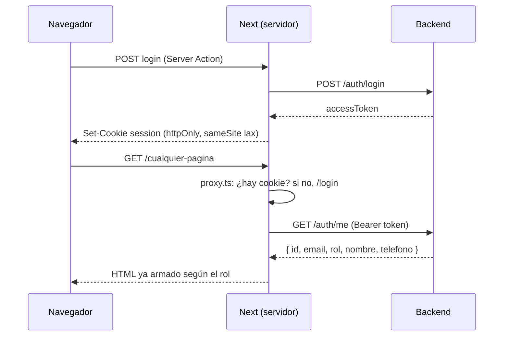

# Decisión: manejo de estado en el frontend (MP4-129)

**Decisión:** no usamos una librería de estado global (Zustand, Redux, Jotai,
etc.). La sesión vive en el servidor con el mecanismo que trae el boilerplate de
Next: una cookie httpOnly con el token y una capa de acceso a datos que le
pregunta al backend quién es el usuario. El resto del estado es local de cada
pantalla.

Fecha: 19 de noviembre de 2026. Autor: Lee Fuentes.

## Cómo funciona hoy

| Pieza | Archivo | Qué hace |
|---|---|---|
| Cookie de sesión | `lib/session.ts` | `createSession`, `getSession` y `deleteSession` sobre la cookie `session` (httpOnly, `secure` en producción, 7 días). |
| Login y registro | `app/actions/auth.ts` | Server Actions: llaman a `POST /auth/login` (y `POST /users` al registrarse) y guardan el token con `createSession`. |
| Usuario actual | `lib/dal.ts` | `getCurrentUser()` llama a `GET /auth/me` con el token; `cache` de React evita repetirlo en un mismo render. `requireUser()` manda al login si no hay sesión válida. |
| Protección por rol | `components/ruta-protegida.tsx` | `RutaProtegida` deja pasar solo a los roles indicados. |
| Chequeo rápido | `proxy.ts` | Sin cookie, toda ruta que no sea pública va a `/login`. |
| Llamadas desde el navegador | `app/api/**/route.ts` y `lib/backend.ts` | Los componentes de cliente nunca ven el token: llaman a un route handler del propio Next, que reenvía al backend con la cookie. |

Hoy hay 30 componentes de cliente y 20 route handlers, y ninguno guarda datos
de sesión en `localStorage`, `sessionStorage` ni en un store global.

## Por qué esta opción

1. **El rol siempre viene del backend.** `GET /auth/me` se consulta en cada
   render del servidor, y el backend también lee el rol de la base en cada
   petición (BE-00.1). Un store en el navegador podría quedarse con un rol
   viejo o alterado; así no hay forma de que la pantalla y el backend se
   contradigan.
2. **El token no es accesible desde JavaScript.** Con la cookie httpOnly, un
   script inyectado no puede leerlo. Si lo guardáramos en un store o en
   `localStorage` para mandarlo desde el navegador, quedaría expuesto.
3. **Casi no hay estado compartido entre pantallas.** Cada pantalla trae sus
   datos (publicación, reserva, conversación, avisos) y los muestra. Lo que sí
   se comparte, quién es el usuario y su rol, ya lo resuelve `getCurrentUser`
   en el servidor y se pasa como prop a los componentes de cliente (por
   ejemplo `usuarioId` y `rol` en `ConversacionReserva`).
4. **Menos piezas.** Una librería más significa hidratación, sincronizar el
   store con la cookie, limpiarlo al cerrar sesión y probar todo eso. Sin
   store no existe ese trabajo ni sus errores.
5. **Es lo que recomienda la guía de Next de esta versión** (autenticación con
   Server Actions, cookie httpOnly y una capa de acceso a datos con
   `server-only`), que es la que trae el boilerplate.

## Alternativas que se descartaron

| Opción | Por qué no |
|---|---|
| **Zustand** (o Redux, Jotai) con el usuario y el token | Duplica lo que ya está en la cookie, obliga a sincronizarlos y expone el token al JavaScript del navegador. No resuelve nada que hoy falte. |
| **React Context** con el usuario | Sirve para no pasar props, pero hoy las pantallas tienen uno o dos niveles de componentes. Si eso cambia, es la primera opción a considerar, siempre llenándolo desde el servidor y sin el token. |
| **Una caché de datos en el cliente** (React Query, SWR) | Útil para mucha consulta repetida desde el navegador. Aquí casi todo se lee en el servidor; la campana de avisos y el chat refrescan a pedido con "Actualizar". |

## El estado que sí vive en el navegador

Es local de cada componente (`useState`) y se pierde al salir de la pantalla,
que es lo que se quiere: el texto que se está escribiendo, si un envío está en
curso, la página del historial cargada, el filtro de la campana. Nada de eso
lo necesita otra pantalla.

## Cuándo revisar esta decisión

- Si varias pantallas empiezan a necesitar los mismos datos del cliente al
  mismo tiempo (por ejemplo, el contador de avisos en el encabezado y en otra
  vista), conviene un Context o una caché de datos, nunca con el token adentro.
- Si se agrega una app móvil o un cliente que no pasa por Next, el token
  tendría que manejarse distinto; eso no afecta a este frontend.

## Relación con otros documentos

- `docs/sesion-y-roles.md`: detalle del registro, la sesión vencida y los roles.
- README del backend: arquitectura general del proyecto.
